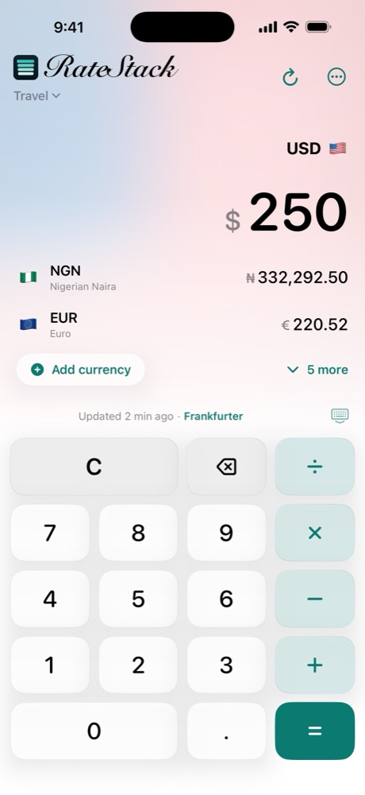
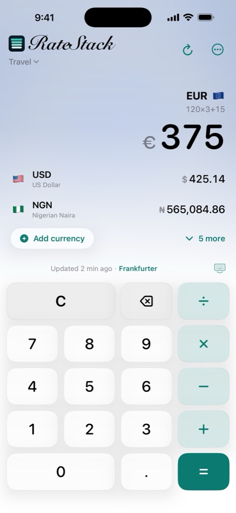
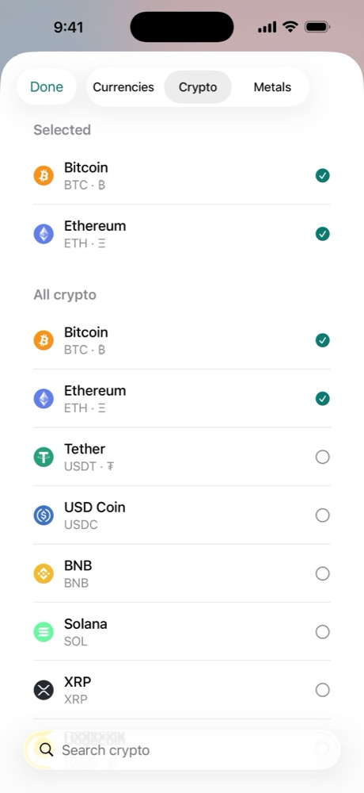
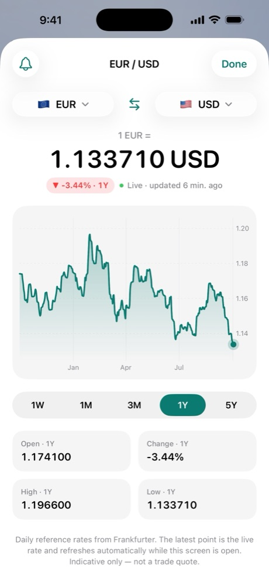
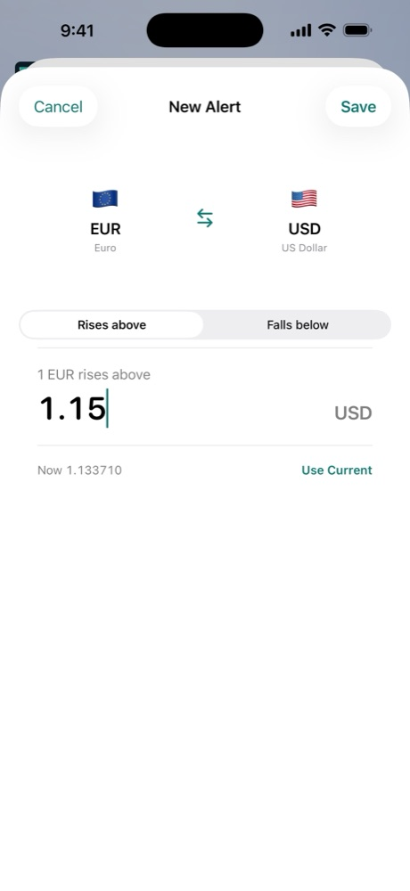
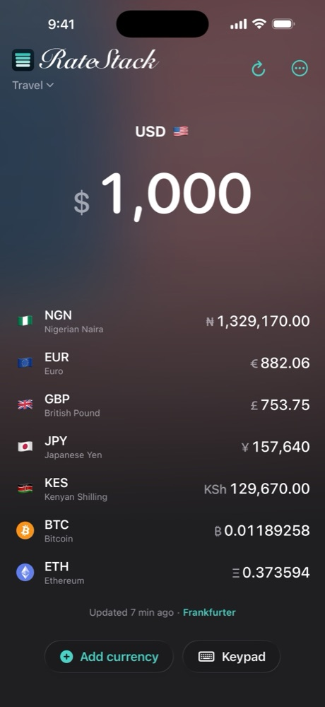

# RateStack

### One amount. Every currency.

A native iOS currency converter built around a single idea:
**tap any currency, type once, and watch every row update instantly.**

[**Website**](https://ratestack.app) · [**Privacy**](https://ratestack.app/privacy) · [**Support**](https://ratestack.app/support)

 

 

## Why RateStack

Most converters make you pick a **From**, pick a **To**, and press **Convert**. RateStack drops all of that.

Keep your currencies in one stack. Tap any row and it becomes the active currency. Type on the built-in keypad and every other row converts as you go, even offline.

- **No selectors.** No From/To pickers, no swap button, no Convert button.
- **Calculator built in.** Type `120 × 3 + 15` and every row updates with the result.
- **Works offline.** Converts from the last good rates, with the source and age always visible.
- **Private by design.** No account, no ads, no tracking, no limits.

 

## Features

<table>
  <tr>
    <td align="center" width="33%">
       
      <b>Calculator keypad</b> 
      Math right in the amount field
    </td>
    <td align="center" width="33%">
       
      <b>Fiat, crypto, and metals</b> 
      160+ currencies, 60 coins, gold, silver, platinum, palladium
    </td>
    <td align="center" width="33%">
       
      <b>Charts and history</b> 
      Rate history for any pair
    </td>
  </tr>
  <tr>
    <td align="center">
       
      <b>Rate alerts</b> 
      Local notifications when a rate crosses your target
    </td>
    <td align="center">
       
      <b>Themes</b> 
      Light, dark, and a Gold theme you earn
    </td>
    <td align="center" valign="middle">
      <b>Also included</b>  
      
        Saved stacks for travel, work, or family 
        Personal rates from your bank or bureau 
        Live crypto prices while open 
        Home Screen and Lock Screen widgets 
        Control Center control (iOS 18) 
        Spotlight, Shortcuts, and Siri
      
    </td>
  </tr>
</table>

 

## Rate sources

Every source is a free, public API, used as its provider allows. Pick one in **Settings → Rate Source**, or leave it on **Automatic** for built-in failover.

| Source | Covers |
| --- | --- |
| [Frankfurter](https://frankfurter.dev) | Official reference rates (primary) |
| [Fawaz Exchange](https://github.com/fawazahmed0/exchange-api) | Wide fiat coverage, crypto and metals fallback |
| [ExchangeRate-API](https://www.exchangerate-api.com) | Open-access daily rates |
| [FloatRates](https://www.floatrates.com) | Daily rates |
| [Coinbase](https://www.coinbase.com) | Crypto spot prices and charts |
| Parallel market | Optional unofficial street rates for NGN, ARS, and VES |

A refresh never replaces your cached rates until the new ones are validated, so a bad response can't wipe what you have.

 

## Built with

- **SwiftUI**, native to iOS 16 and later, with Liquid Glass controls on iOS 26
- **WidgetKit** and **App Intents** for widgets, controls, Shortcuts, and Siri
- **`Decimal` math** for every amount and rate, never floating point
- **Zero third-party runtime dependencies**

 

## Privacy

RateStack collects no data. There's no account, no analytics, and no advertising SDK. Your stacks, alerts, and history stay on your device. The App Store privacy label reads **Data Not Collected**. Read the full [privacy policy](https://ratestack.app/privacy).

 

---

Rates are indicative reference rates and may differ from banks or transfer services. RateStack doesn't execute trades or move money. 
This repository hosts project information only. The app's source code is private.  
© 2026 BeggiBeggi

